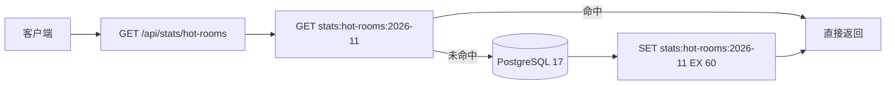

# 第 51 章 快速入门 Redis

先把 Redis 摆对位置，这一章后面就不会拧。

PostgreSQL 是档案室：数据写在硬盘上，有表、有外键、有事务，断电了也还在，但每次进去调一份档案都要走一趟流程，慢一点。Redis 是随手放在桌上的小本子：数据放在内存里，左边写名字（key）、右边写内容（value），翻得极快，但本子不大，也不保证每一页都留得住。

所以 Redis 不是「另一套 PostgreSQL」。它不替代主库，不负责长期保管业务数据，只负责那些「这一小段时间里会被反复看、丢了也能重建或重来」的东西——缓存结果、会话、计数器。拿它当唯一数据库，等于把合同只写在白板上。

**键值数据库**这个词听着唬人，说穿了就是「按名字取东西」的柜子：给它一个 key（比如 `room:42:status`），它把那件东西还给你。名字和内容都是你自己定的，它不关心内容长什么样。也正因为不关心，它才快——不用解析表结构、不用检查外键。

**缓存**是它最常见的用法：把数据库算过一遍的结果先记在小本子上，下次先翻本子，有就直接用，没有再回数据库算，算完再记上去。这个流程有个名字叫 cache-aside（旁路缓存），意思是缓存站在数据库旁边，读的时候先问它，写的时候绕开它。

**TTL**（time to live，存活时间）是给每一条记录写的「保质期」。到了点它就不该再被当成有效数据。它是缓存和数据库不一致时的最后一道保险，不是可选项。

后端拿 Redis 干两类事：缓存，以及轻量状态（计数器、排行榜、会话、分布式锁——多个实例抢同一把锁，保证只有一个能执行）。这两类事的共同点是：小、快、丢了能重建。

官方文档（先看懂正文再点）：
- [Redis 文档](https://redis.io/docs/latest/)：Redis 的总入口，先知道它能干什么。
- [Redis 数据类型](https://redis.io/docs/latest/develop/data-types/)：String、Hash、List、Set、ZSet 各适合存什么，对应本章中间那张表。
- [Redis 命令参考](https://redis.io/docs/latest/commands/)：每个命令的参数和复杂度，写代码时逐条查。

## 首页那个榜单是怎么把库压垮的

会议室预订系统上线第二周，运营在首页加了个「本月热门会议室」榜单，按预订数倒序取前十。数据量不大，但首页每次刷新都要扫一遍 `bookings` 做聚合，晚高峰 QPS（每秒请求数）从 200 涨到 4000，数据库 CPU 直接顶满，榜单接口 p99（99% 请求的耗时）从 80ms 变成 1.2 秒。

问题不是 SQL 慢，是把一份一分钟内都不会变的结果重复算了四千次。像全办公室每个人来问一次「今天几号」，你都翻一遍日历再回答。这种「算一次、存起来、下次直接拿」的需求，正是缓存的主场；但缓存一进来，就要回答三个问题：存什么、存多久、什么时候删。

> **图 51-1** 一次读请求在缓存和数据库之间的走向，命中与未命中各走哪条路。
>



图里那个「命中」就是本子上正好有、「未命中」就是本子上没有、得回数据库算。缓存代码写的其实全是这两种情况的分支。

## 先把它跑起来

example 的 `docker-compose.yml` 里已经有 Redis，镜像就是 `redis:8`：

```yaml
# docker-compose.yml（节选）
services:
  redis:
    image: redis:8
    container_name: meeting-booking-redis
    restart: unless-stopped
    command: ['redis-server', '--appendonly', 'yes']  # AOF 持久化，把写命令追加进日志
    ports:
      - '6379:6379'
    volumes:
      - redis-data:/data
    healthcheck:
      test: ['CMD', 'redis-cli', 'ping']
      interval: 5s
      timeout: 3s
      retries: 10
```

```bash
docker compose up -d redis
docker compose exec redis redis-cli ping
# PONG
```

`PONG` 出来就说明服务通了。接着试最基本的读写：

```bash
docker compose exec redis redis-cli set room:42:status available
# OK
docker compose exec redis redis-cli get room:42:status
# "available"
docker compose exec redis redis-cli del room:42:status
# (integer) 1
```

`set` 是往本子上写一行，同名就覆盖；`get` 是照名字念出来，本子上没有就回 `(nil)`（空）；`del` 是撕掉那一页，返回撕掉了几张。就这三条命令，已经能撑起一个最简单的缓存。（以上为示例输出，本机没有运行 Redis 容器，未实测。）

Redis 8 把原来 Redis Stack（Redis 官方把模块打包在一起的发行版）的 JSON、Search、TimeSeries、Bloom 系列并进了主发行版，镜像里直接能用 `JSON.SET`、`FT.SEARCH`。做业务缓存时这些可以先不碰，知道它们在那儿就行；真要用，键名和普通字符串共享同一个命名空间，别撞车。

## 五种结构，先选对再写命令

Redis 的 key 都是字符串，值有类型。类型选错，后面不是多绕几圈代码，就是多存几倍内存。可以按「你要把东西放成什么形状」来选：

| 结构 | 典型命令 | 会议室系统里的用法 | 注意 |
| --- | --- | --- | --- |
| String | `SET` `GET` `INCR` | 缓存 JSON、计数器、分布式锁 | 单值别超过几 MB |
| Hash | `HSET` `HGET` `HGETALL` | 会话、对象的部分字段更新 | 字段多时 `HGETALL` 是 O(N) |
| List | `LPUSH` `RPOP` `LRANGE` | 简单队列、最新动态 | 没有确认机制，消费失败会丢 |
| Set | `SADD` `SMEMBERS` `SINTER` | 标签、去重、共同好友 | 大集合的 `SMEMBERS` 会阻塞 |
| ZSet | `ZADD` `ZINCRBY` `ZRANGE` | 排行榜、延迟队列 | 分值相同时按成员字典序排 |

打个比方：String 是一张便利贴，只写一件事；Hash 是一个带格子的抽屉，每个格子放一个字段，改一格不用把整个抽屉倒出来；List 是一条排队通道，从一头进、另一头出；Set 是抽奖箱，同一个名字扔两次也只算一个；ZSet 是排行榜，每个人除了名字还带一个分数，能按分数取前几名。

Redis 的命令执行是单线程的：网络 IO 可以多线程，但命令还是一条条串行执行。像柜台只有一个收银员，你点一单特别复杂的，后面所有人一起等。所以单条 O(N)（耗时随元素数量线性增长）命令会堵住整个实例，`KEYS *`、几万字段的 `HGETALL` 在生产里都是危险操作——不是「慢一点」，是让所有客户端一起等。

看几个真实命令。计数器用 String 的原子自增，不需要先读再写：

```bash
docker compose exec redis redis-cli incr stats:bookings:2026-11-06
# (integer) 1
docker compose exec redis redis-cli incrby stats:bookings:2026-11-06 3
# (integer) 4
```

「原子」的意思是这一加要么完整发生、要么不发生，两个请求同时 `INCR` 也不会都读到 3 再各加一次变成 4。这是 Redis 单线程执行送的好处，不用你自己加锁。

会话用 Hash，改一个字段不用把整个对象读出来再写回去：

```bash
docker compose exec redis redis-cli hset session:u_1 userId u_1 role MEMBER name 张三
# (integer) 3
docker compose exec redis redis-cli hget session:u_1 role
# "MEMBER"
docker compose exec redis redis-cli hgetall session:u_1
# 1) "userId"
# 2) "u_1"
# 3) "role"
# 4) "MEMBER"
# 5) "name"
# 6) "张三"
```

排行榜用 ZSet，`ZINCRBY` 把分数加上去，`ZRANGE ... REV` 从高到低取：

```bash
docker compose exec redis redis-cli zadd ranking:2026-11 120 room:42
# (integer) 1
docker compose exec redis redis-cli zincrby ranking:2026-11 30 room:42
# "150"
docker compose exec redis redis-cli zrange ranking:2026-11 0 9 rev withscores
# 1) "room:42"
# 2) "150"
```

列表适合「先进先出」的轻量队列：

```bash
docker compose exec redis redis-cli lpush queue:notifications '{"bookingId":"b_1"}'
# (integer) 1
docker compose exec redis redis-cli rpop queue:notifications
# "{\"bookingId\":\"b_1\"}"
```

但别把它当可靠消息队列用：`RPOP` 成功、业务处理失败，这条消息就没了。要确认和重试，用 Stream 的消费组（Stream 是 Redis 的日志型结构，消费组支持确认和重投），或者干脆上专门的消息队列。

## TTL：过期不是定时器

给 key 加过期时间，最常用的是 `SET` 直接带 `EX`：

```bash
docker compose exec redis redis-cli set room:42:detail '{"name":"星河会议室"}' EX 60
# OK
docker compose exec redis redis-cli ttl room:42:detail
# (integer) 57
```

`TTL` 返回剩余秒数，`-1` 表示没有过期时间，`-2` 表示 key 不存在。这两个负数经常被当成一回事，写代码时要注意区分：`-1` 是「永不过期」，`-2` 才是「没有」。

```bash
docker compose exec redis redis-cli ttl room:does-not-exist
# (integer) -2
docker compose exec redis redis-cli set room:42:detail '{"name":"星河会议室"}'
# OK
docker compose exec redis redis-cli ttl room:42:detail
# (integer) -1
```

注意第二条 `SET` 没带 `EX`，原来那 60 秒的 TTL 被清掉了，key 变成永不过期。用普通 `SET` 覆盖缓存时，TTL 不会自动保留，这是线上「内存慢慢涨」的常见来源。

「过期」听起来像有个闹钟到点就删，其实不是。Redis 用的是「惰性 + 定期抽样」：访问到已过期的 key 时顺手删，后台再随机抽一部分带 TTL 的 key 清理。所以 TTL 到了不代表内存立刻释放，`INFO memory` 里看到已过期 key 还占着空间是正常的。

还有一个容量上的细节：不要把几十万个 key 的过期时间设成同一秒。到点之后主动过期线程要清理一大片，CPU 会抖一下；给 TTL 加一点随机抖动，比如 `60 + random(0, 15)` 秒，能把压力摊开。

## 持久化：重启之后数据还在不在

Redis 是内存数据库，但可以把数据落到磁盘。两种方式，像两种记账习惯：

- **RDB**：按时间点拍一张全景照。默认配置里有三个 save 点（3600 秒内 1 次修改、300 秒内 100 次、60 秒内 10000 次），触发 `BGSAVE` fork 子进程写 `dump.rdb`。恢复快，但两次快照之间的数据会丢。
- **AOF**：把每条写命令记进流水账。`appendfsync everysec` 最多丢约 1 秒；`always` 基本不丢但性能差；`no` 交给操作系统，丢得更多。

example 的 compose 启动参数是 `--appendonly yes`，也就是 RDB 和 AOF 都开着。确认一下：

```bash
docker compose exec redis redis-cli config get appendonly
# 1) "appendonly"
# 2) "yes"
docker compose exec redis redis-cli info persistence | grep -E 'aof_enabled|rdb_last_bgsave_status|aof_last_write_status'
# aof_enabled:1
# rdb_last_bgsave_status:ok
# aof_last_write_status:ok
```

`aof_enabled:1` 说明 AOF 生效；两个 `status:ok` 说明最近一次落盘没出错。如果 `rdb_last_bgsave_status` 是 `err`，多半是磁盘满了或者 `/data` 没权限，别等到重启才发现。

但持久化不等于备份。`FLUSHALL`、误删 key、逻辑写坏，AOF 会忠实地把这些操作也记下来。生产上还是要定期把 RDB 文件传到对象存储，并且验证能恢复；Redis 8 的 ACL（访问控制列表，按用户限定能执行哪些命令、能访问哪些 key）也建议按应用分配账号，别让所有服务共用一个 `default` 用户。

还要给内存设上限。`maxmemory` 不设，内存涨到机器 OOM（内存耗尽，进程被杀）；设了但 `maxmemory-policy` 保持默认的 `noeviction`，写满后写入直接报错、读还能继续——看起来像随机故障。桌子就这么大，新东西放不下时得决定扔哪本旧本子：纯缓存实例一般用 `allkeys-lru`（内存满时按最近最少使用淘汰任意 key）；会话、队列和缓存混用时最好拆实例，别让淘汰策略把不能丢的数据淘汰掉。

## 把命令拼成流程

回到那个榜单接口。cache-aside 在命令行里就是三步：先 `GET`，未命中就算、再 `SET EX`：

```bash
docker compose exec redis redis-cli get stats:hot-rooms:2026-11
# (nil)，未命中
docker compose exec redis redis-cli set stats:hot-rooms:2026-11 '[{"roomId":"room:42","count":150}]' EX 60
# OK
```

写入侧则相反：先改库，再 `DEL stats:hot-rooms:2026-11`。删而不是 `SET` 新值，是因为两个并发写请求的 `SET` 顺序可能和数据库提交顺序相反，缓存就留下旧值；删掉之后，下一次读自然会回源。TTL 是最后一道保险，别设成永不过期。

计数器用 `INCR` 天然原子，但别忘了给 key 设过期，否则日统计会无限增长：

```bash
docker compose exec redis redis-cli incr stats:bookings:2026-11-06
docker compose exec redis redis-cli expire stats:bookings:2026-11-06 86400
```

`INCR` 和 `EXPIRE` 是两条命令，中间进程挂了就会留下一个没有 TTL 的 key。要求严格时用 Lua（Redis 内置的脚本语言，整段原子执行）把两步包成一次执行，或者接受这点泄漏、靠定期巡检清理。

排行榜按天分 key，比如 `ranking:2026-11-06`，再给一个 7 天的过期时间，历史榜单自然淘汰。会话用 Hash 存用户 id、角色，`EXPIRE` 续期；会话 key 一定要有 TTL，否则用户退出后数据永远留在内存里，退出时主动 `DEL`，TTL 只是兜底。

## 先判断值不值得缓存

不是所有查询都该往 Redis 里塞。缓存是额外的一层，就多一种失败模式：Redis 挂了、key 被误删、数据和库里对不上，任何一个都会变成线上问题。动手前先过三个问题：

- 读是不是明显多于写？读多写少，缓存命中率才起得来；写比读还频繁，缓存只会增加不一致窗口。
- 能不能接受短暂不一致？会议室列表晚 30 秒更新通常没事，余额、库存这类就不能只靠 TTL 兜底。
- 回源是不是真的贵？单条按主键查、有索引、几毫秒就回来的查询，加一层缓存省下的时间还不够一次网络往返。

三个都答「是」，再缓存。另外，多副本部署时别用进程内缓存代替 Redis：每个 Pod 各存一份，用户刷新两次可能看到两个结果，失效时也删不干净。本地缓存只适合极热、极稳定、能容忍短时间不一致的数据。

缓存还有三个绕不开的故障，名字听起来玄，本质都是「回源请求在同一时刻堆到了数据库上」：

- **穿透**：查一个不存在的 id，每次都穿过缓存打数据库。像有人拿一张假名字来问，你每次都得翻一遍全库确认没有。解法是缓存空值并给短 TTL。
- **击穿**：某个热点 key 刚好过期，大量请求同时回源。像全楼只有一个电梯，检修那一秒所有人都走楼梯。解法是互斥重建或逻辑过期。
- **雪崩**：大批 key 在同一秒过期。解法是给 TTL 加随机抖动、做多级缓存。

## 生产里真正会踩的坑

| 现象 | 原因 | 怎么处理 |
| --- | --- | --- |
| 执行 `KEYS *` 后所有接口卡住 | `KEYS` 是 O(N)，单线程被占满 | 用 `SCAN` 游标遍历，或按业务前缀维护索引 |
| 内存突然打满，写入报 OOM | `maxmemory-policy` 默认 `noeviction` | 缓存实例设 `allkeys-lru`，并配 `maxmemory` |
| 同一时刻大量 key 过期，CPU 抖动 | TTL 集中 | 加随机抖动，错开过期时间 |
| 读到的缓存和数据库不一致 | 先删缓存再写库，或并发双写 | 先写库再删缓存，TTL 兜底 |
| `HGETALL` 一个几万字段的 hash 变慢 | 大 key，单次返回数据量大 | 拆 key、分页读，或改用多个小 hash |
| 重启后缓存全空，数据库被打穿 | 只依赖 Redis，没做回源保护 | 缓存预热、回源限流、空值缓存 |

再补三条：

- **`MONITOR` 不要在生产长时间开**。它会把每条命令都推给客户端，本身就会拖慢实例，排查完立刻停。
- **`FLUSHALL` 没有回收站**。执行前确认连的是哪个实例，生产账号不要给 `FLUSHALL` 权限。
- **缓存空值也要设短 TTL**。查不到的 id 每次都回源，就是缓存穿透；存一个 30 秒的空标记，能挡住大部分重复请求。

命令行到这里够用了。下一章把这些命令搬进 Nest：连接怎么建、断线怎么重连、缓存 key 怎么统一管理，以及为什么不该在每个 service 里裸写 `get`/`set`。


<!-- chapter-nav:start -->
---

← 上一篇：[050 在Nest里集成Prisma8](050-在Nest里集成Prisma8.md) · [本 Part 目录](_part.md) · 下一篇：[052 在Nest里操作Redis](052-在Nest里操作Redis.md) →
<!-- chapter-nav:end -->
