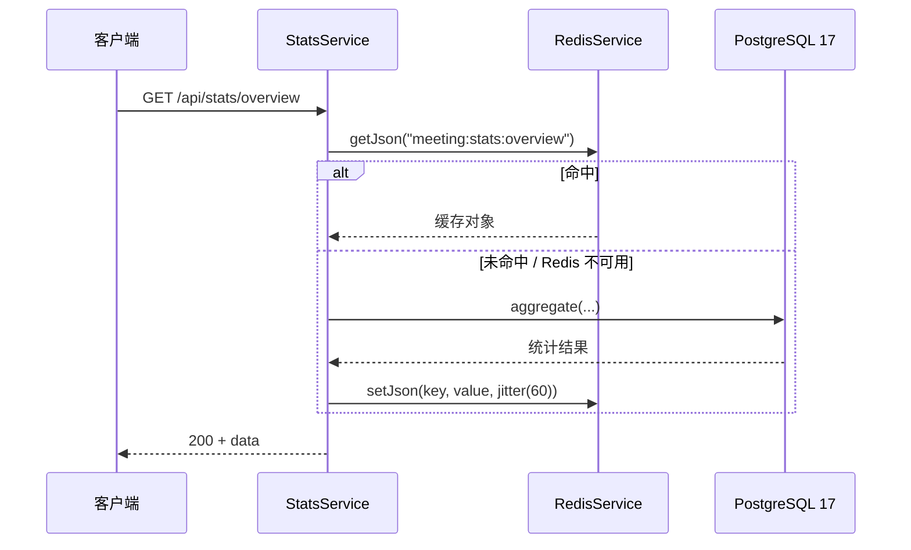

# 第 52 章 在 Nest 里操作 Redis

## 先认识 ioredis 和「可选依赖」

`ioredis` 是 Node 里最常用的 Redis 客户端。`new Redis(url)` 建立的是一条到 Redis 的 TCP 长连接，所有命令都在这条连接上排队发送，结果再按 RESP（Redis 的通信协议）的回复顺序配回各自的 Promise。它没有 pg 那种「借出 / 归还」的池语义，连接就一条——这条连接的健康状况，直接决定缓存能不能用。

Node 的 EventEmitter 对 `error` 事件有一条特殊规则：普通事件没人监听等于没发生，`error` 没人监听则会被升级成未捕获异常，直接结束进程。Redis 连接抖动时客户端会发 `error`；没挂监听，一次断线就能带走整个服务。

Redis 做主从切换时，主节点故障、从节点接管，客户端这条连接会断开再重连。缓存本该是可选依赖：Redis 不在了，接口慢一点、回源查库就行。可一旦客户端接错，它就会变成必需依赖——一条连接上的意外能把整个服务拖下水。

官方文档（先看懂正文再点）：
- [ioredis](https://github.com/redis/ioredis)：客户端 API、重连和事件，本章 `new Redis(url)` 那段对应它的构造函数。
- [Nest 缓存](https://docs.nestjs.com/techniques/caching)：Nest 自带的缓存模块，和 ioredis 是两条路。
- [Redis 文档](https://redis.io/docs/latest/)：命令和协议本身的说明。

现在看一个真实事故。

凌晨两点，Redis 做了一次主从切换。切换本身只花了两秒，但应用容器连着重启了三次，退出码都是 1。统计接口本身没坏——坏的是进程：连接上抛出的一个错误没有人接，Node 直接把它当成未捕获异常，把进程带走了。

这一章把这件事从头接对：连接怎么建、断了怎么降级、key 和 TTL 放哪、批量和原子怎么做，最后真的把 Redis 停一次，看业务是不是还活着。

## 一条长连接，不是一组连接

连接只有一条，所以 ioredis 没有 pg 那种「借出 / 归还」的池语义，也没有 `max` 参数。命令在这条连接上多路复用：客户端按顺序写进去，再按 RESP 协议的回复顺序把结果配回各自的 Promise。这一点决定了它接进 Nest 的方式和数据库客户端不一样。

连接是有状态的。`client.status` 依次会经过 `connecting`、`connect`、`ready`，断线时变 `close`，然后 `reconnecting`，直到 `end` 彻底结束。这个字段后面判断「能不能发命令」时会反复用到。

另一件默认行为更重要：断线期间，新来的命令不会立刻失败，而是排进内存里的离线队列，等重连成功后一起补发。对消息队列也许合适，对缓存完全没必要——用户等的是这一秒的响应，不是三秒后补发的那个 `GET`。队列越长，内存越高，请求挂得越久。

## 让它允许失败

`REDIS_CLIENT` 这个 token 在 example 里是用 symbol 定义的（`src/redis/redis.constants.ts`），provider 读配置、建客户端，并且允许返回 `null`：

```ts
// src/redis/redis.provider.ts
import { Logger, type Provider } from '@nestjs/common';
import { ConfigService } from '@nestjs/config';
import { Redis } from 'ioredis';
import { REDIS_CLIENT } from './redis.constants.js';

const logger = new Logger('RedisProvider');

export const redisClientProvider: Provider = {
  provide: REDIS_CLIENT,
  inject: [ConfigService],
  useFactory: (config: ConfigService): Redis | null => {
    const url = config.get<string>('redis.url');
    if (!url) {
      logger.warn('REDIS_URL 未配置，缓存将直接回源数据库');
      return null;
    }

    const client = new Redis(url, {
      lazyConnect: true,
      maxRetriesPerRequest: 1,
      enableOfflineQueue: false,
      connectTimeout: 3_000,
      retryStrategy: (times) => Math.min(times * 200, 2_000),
    });

    client.on('error', (error: Error) => {
      logger.warn(`Redis 连接异常：${error.message}`);
    });

    return client;
  },
};
```

`client.on('error', ...)` 不是可选的日志装饰。监听要在 `connect()` 之前挂上——第一次连接失败是很容易发生的，那时候再挂就晚了。

其余四个选项各管一段：

- `lazyConnect: true`——`new Redis()` 不立刻发起连接，等 `onModuleInit` 里显式 `connect()`。Redis 没起来时应用还能启动，只是缓存降级。
- `enableOfflineQueue: false`——关掉前面说的离线队列。断线期间命令立刻失败，不堆积、不补发。
- `maxRetriesPerRequest: 1`——单条命令最多重试一次，配合上一条保证「快速失败」，而不是把 HTTP 请求挂住。
- `retryStrategy`——后台重连节奏，从 200ms 起，最多 2 秒。不写它也会重连，但默认节奏不好排查，写出来更直观。

这四个参数合起来表达一件事：**连接可以断，命令可以失败，但请求不能挂**。

## 服务层：连上、断开、恢复

`RedisService` 构造器注入 `REDIS_CLIENT`，拿到的可能是 `null`。真正容易写错的是状态维护：

```ts
// src/redis/redis.service.ts（节选）
async onModuleInit(): Promise<void> {
  if (!this.client) {
    this.logger.warn('REDIS_URL 未配置，统计缓存将降级为直接查询数据库');
    return;
  }

  this.client.on('ready', () => {
    this.available = true;
    this.logger.log('Redis 已就绪，缓存已启用');
  });
  this.client.on('close', () => {
    this.available = false;
    this.logger.warn('Redis 连接断开，缓存降级');
  });

  try {
    await this.client.connect();
  } catch (error) {
    this.available = false;
    this.logger.warn(`Redis 首次连接失败，缓存降级：${this.describe(error)}`);
  }
}
```

`ready` 和 `close` 两个事件驱动了 `available` 标记。反过来写——只在 `connect()` 成功那一行把 `available = true`——就会留下一个很隐蔽的 bug：启动时 Redis 恰好没起来，标记永远是 `false`，可 ioredis 后台其实已经重连成功了，缓存却再也不会恢复。表现是「服务重启一次之后就再也不命中缓存」，很难往这个方向想。

关闭的时候要区分状态：

```ts
// src/redis/redis.service.ts（节选）
async onModuleDestroy(): Promise<void> {
  if (!this.client) {
    return;
  }

  try {
    if (this.client.status === 'ready' || this.client.status === 'connect') {
      await this.client.quit();
    } else {
      this.client.disconnect();
    }
  } catch (error) {
    this.logger.warn(`Redis 关闭失败：${this.describe(error)}`);
    this.client.disconnect();
  }
}
```

`quit()` 会发 `QUIT` 并等在途命令跑完；`disconnect()` 直接掐断。连接已经断了或者还在重连时，`quit()` 可能一直等下去，所以先看 `status`。这段要在进程退出时真的被执行，还得靠 `main.ts` 里的 `app.enableShutdownHooks()`。

对外的 `getJson` / `setJson` 保持同一个约定：读失败返回 `null`，写失败静默。业务代码不用包 `try/catch`，但必须接受「可能没有缓存」，并且有回源路径。

> **图 52-1** 统计接口读缓存、回源、写缓存的完整路径。



## 停一次 Redis，看降级是不是真的

先确认缓存确实生效。开一个终端盯命令：

```bash
docker compose exec redis redis-cli monitor
```

另开一个终端请求两次：

```bash
curl -s http://localhost:3000/api/stats/overview > /dev/null
curl -s http://localhost:3000/api/stats/overview > /dev/null
```

示例输出（`monitor` 里应该看到这样的三行）：

```text
1700000000.101 [0 172.18.0.1:52344] "GET" "meeting:stats:overview"
1700000000.115 [0 172.18.0.1:52344] "SET" "meeting:stats:overview" "{\"totalRooms\":12,...}" "EX" "63"
1700000000.900 [0 172.18.0.1:52344] "GET" "meeting:stats:overview"
```

第一次是 `GET` 未命中、回源、再 `SET ... EX 63`（60 秒加抖动），第二次只剩 `GET`。第二次如果还有 `SET`，先查 TTL 有没有真的传进 `setJson`，再查 key 是不是每次请求都在变。

然后把 Redis 停掉：

```bash
docker compose stop redis
curl -s -o /dev/null -w '%{http_code}\n' http://localhost:3000/api/stats/overview
# 200
```

预期还是 200，日志里出现「Redis 连接断开，缓存降级」，请求多花一次查库的时间。这是整章最该验证的一步：**缓存挂掉不能把业务带死**。如果这里返回 500，回头查两处——`getJson` 是不是漏了 `try/catch`，或者 `available` 的判断写反了。

再启回来：

```bash
docker compose start redis
sleep 3
curl -s -o /dev/null -w '%{http_code}\n' http://localhost:3000/api/stats/overview
# 200，日志出现「Redis 已就绪」
```

日志迟迟不出现「已就绪」，多半是 `ready` 监听没挂，或者 `retryStrategy` 返回了 `null`（那等于主动停止重连）。两种写法在监控上长得一样：缓存再也不命中。

## key 和 TTL 收口

key 散在各个 service 里，早晚会撞名，也早晚会有人忘了设 TTL。集中到一个文件：

```ts
// src/redis/cache-keys.ts
const PREFIX = 'meeting';

export const cacheKeys = {
  statsOverview: `${PREFIX}:stats:overview`,
  roomDetail: (roomId: string) => `${PREFIX}:room:${roomId}:detail`,
  hotRooms: (month: string) => `${PREFIX}:stats:hot-rooms:${month}`,
} as const;

export const cacheTtl = {
  statsOverview: 60,
  roomDetail: 300,
} as const;

export const jitter = (seconds: number): number =>
  seconds + Math.floor(Math.random() * Math.max(1, Math.round(seconds * 0.2)));
```

前缀里再带环境和版本，比如 `meeting:staging:v1:`。多套环境共用一个 Redis 时，这是唯一能挡住测试数据污染生产的东西；缓存结构变了就升 `v1`，老 key 靠 TTL 自然淘汰，不用写迁移脚本。

`jitter` 把 60 秒打散成 60 到 72 秒。没有它，同一个 key 在几十个实例上会同时过期、同时回源，数据库瞬间挨一轮。这个函数只该用在缓存过期时间上，别拿去生成订单号。

## 业务侧长什么样

```ts
// src/modules/stats/stats.service.ts（节选）
const cached = await this.redis.getJson<StatsOverview>(cacheKeys.statsOverview);
if (cached) {
  return cached;
}

const overview = await this.loadOverviewFromDatabase();
await this.redis.setJson(
  cacheKeys.statsOverview,
  overview,
  jitter(cacheTtl.statsOverview),
);
return overview;
```

这就是 cache-aside：先读缓存，未命中查库，再把结果写回。写路径也一样直接——数据变更后 `await this.redis.del(key)`，让下一次读去重建。删而不是改，是因为改缓存要处理并发写覆盖，而删只有「没有」这一种结果。

## 序列化不是免费的

`setJson` 内部是 `JSON.stringify`，`getJson` 是 `JSON.parse`。够用，但有三条边界必须知道：

- `Date` 会变成 ISO 字符串，读回来不再是 `Date` 对象。缓存 DTO 里统一用字符串时间，别在类型上写 `Date` 骗自己。
- `undefined` 字段会被丢掉；`Map`、`Set`、`BigInt` 要么序列化失败，要么变成 `{}`。
- 类实例会退化成普通对象，原型上的方法不会回来。

还有脏数据。缓存里的 JSON 可能来自上一个版本，也可能被人手改过，`JSON.parse` 抛错不能把接口带崩：

```ts
// src/redis/redis.service.ts（节选）
try {
  return raw ? (JSON.parse(raw) as T) : null;
} catch (error) {
  this.logger.warn(`缓存值损坏，删除 ${key}：${this.describe(error)}`);
  await this.client.del(key).catch(() => undefined);
  return null;
}
```

删掉坏 key，下一次请求自然重建。不删的话，这个 key 会在 TTL 到期前持续命中失败。

## 批量用 pipeline，原子性用 Lua

一次要取 20 个会议室详情，循环 `await getJson` 就是 20 次往返。pipeline（把多条命令打包一次发送、一次收结果）把这些命令一次性发出去、一次收齐结果：

```ts
// src/redis/redis.service.ts（追加）
async getMany<T>(keys: string[]): Promise<Map<string, T>> {
  const found = new Map<string, T>();
  if (!this.available || !this.client || keys.length === 0) {
    return found;
  }

  const pipeline = this.client.pipeline();
  for (const key of keys) {
    pipeline.get(key);
  }

  try {
    const results = await pipeline.exec();
    if (!results) {
      return found;
    }
    results.forEach(([error, value], index) => {
      if (error || typeof value !== 'string') {
        return;
      }
      try {
        found.set(keys[index]!, JSON.parse(value) as T);
      } catch {
        // 单个 key 损坏不影响整批。
      }
    });
  } catch (error) {
    this.logger.warn(`Redis pipeline 失败：${this.describe(error)}`);
  }

  return found;
}
```

`pipeline.exec()` 返回 `[error, result][]`，单条命令失败不会让整个调用抛异常，所以要逐个看 `error`。它省的是网络往返，不是隔离性——pipeline 不是事务，中间可能插进别的客户端的命令。

需要「要么都成、要么都没发生」时，用 Lua 脚本。脚本在 Redis 里整段原子执行，跑完之前不会插进其他命令；代价是脚本不能太长，否则会像一条慢命令那样堵住整个实例。典型的例子是计数和过期必须一起成功：

```ts
// src/redis/redis.service.ts（追加）
private static readonly INCR_WITH_TTL = `
local current = redis.call('INCR', KEYS[1])
if current == 1 then
  redis.call('EXPIRE', KEYS[1], ARGV[1])
end
return current
`;

async incrementWithTtl(key: string, ttlSeconds: number): Promise<number | null> {
  if (!this.available || !this.client) {
    return null;
  }

  try {
    const result = await this.client.eval(RedisService.INCR_WITH_TTL, 1, key, ttlSeconds);
    return Number(result);
  } catch (error) {
    this.logger.warn(`Redis EVAL ${key} 失败：${this.describe(error)}`);
    return null;
  }
}
```

`eval(script, numkeys, ...args)` 里的 `1` 表示后面第一个参数是 key，其余进 `ARGV`。脚本里所有 key 都必须通过 `KEYS` 传，不能在脚本里拼字符串，否则集群模式下会路由错节点。将来真上 Redis Cluster，一个脚本里的多个 key 还必须落在同一个 slot，得用 `{user:42}:count`、`{user:42}:ttl` 这种 hash tag（用花括号把同一类 key 的哈希槽绑在一起）把它们绑在一起，否则 `EVAL` 直接报 `CROSSSLOT`。

每次 `eval` 都要传整段脚本，Redis 会缓存，但网络传输省不掉。调用频繁就改成 `defineCommand`，让 ioredis 走 `EVALSHA`——只传脚本的 SHA1。脚本不长、调用不密时，现在这样够了。

## pub/sub 只适合通知

预订创建后要让统计缓存失效，可以用 pub/sub（发布 / 订阅：发布者往频道发消息，订阅者各自接收，消息不落盘、不重放）：

```ts
// src/redis/booking-events.subscriber.ts（节选）
const subscriber = this.client.duplicate();
subscriber.on('message', (channel, message) => {
  this.logger.log(`收到 ${channel}：${message}`);
});
await subscriber.subscribe('booking:created');
```

`duplicate()` 是必须的：一条连接进入订阅模式后就不能再执行普通命令，得另开一条。订阅端还要在 `onModuleDestroy` 里先 `unsubscribe` 再 `quit`，否则进程退出时连接会挂着。

但 pub/sub 是「发出去就不管」：没有持久化、没有确认、没有重放，订阅端断线期间的消息直接丢失。它适合「缓存失效通知」这种丢了也能靠 TTL 兜底的场景；订单、通知这类不能丢的，用 Redis Stream 的消费组，或者上专门的消息队列。

## 生产里真正会踩的坑

| 现象 | 原因 | 怎么处理 |
| --- | --- | --- |
| 应用随机重启，日志 `Unhandled 'error' event` | ioredis 没有挂 error 监听 | Provider 里 `on('error')`，且在 `connect()` 前挂 |
| Redis 恢复后缓存一直不生效 | 只在首次 `connect()` 成功时置 `available` | 监听 `ready` / `close` 维护状态 |
| 断线期间内存上涨、请求变慢 | 默认离线队列在堆积命令 | `enableOfflineQueue: false` + 低 `maxRetriesPerRequest` |
| 缓存里读出的时间和写入时不一样 | JSON 把 `Date` 变成了字符串 | 统一存 ISO 字符串，读时显式转换 |
| 批量取 50 个 key 要 50 次往返 | 循环 `await get` | pipeline 或 `mget` |
| 计数 key 没有 TTL，内存只涨不降 | `INCR` 和 `EXPIRE` 分开执行，中间失败 | Lua 包成一次，或定时巡检补 TTL |
| 订阅端收不到消息 | 用同一条连接做订阅 | `duplicate()` 单独开订阅连接 |

最后三条经验：

- **不要拿 Redis 的可用性决定 HTTP 健康检查**。缓存挂了，接口应该慢一点，而不是整个实例被摘掉。Redis 状态进指标和日志，readiness 仍然只看数据库。
- **`keys()` 和 `scanStream()` 都要小心**。`keys()` 在生产是禁用词；`scanStream()` 虽然不阻塞，但遍历大库时网络和内存开销不小，只在前缀明确、数据量可控时用。
- **给缓存加指标**。至少要有命中率——没有命中率，你无法判断这层缓存到底有没有用。

到这里，ioredis 能给的能力基本过了一遍。下一章回答一个选型问题：Nest 官方 caching 默认推荐 cache-manager，为什么这个项目仍然直接上 ioredis。

想更深入的话，官方文档里有这几页可以接着看：[ioredis README](https://github.com/redis/ioredis)（连接选项、重试策略和事件列表）、[Nest 缓存](https://docs.nestjs.com/techniques/caching)（`CacheModule` 的用法，第 53 章会对比）、[Redis Pipeline](https://redis.io/docs/latest/develop/using-commands/pipelining/)（一次发多条命令、少等几个来回）、[Redis Lua 脚本](https://redis.io/docs/latest/develop/programmability/eval-intro/)（把多条命令写成原子操作）。

<!-- chapter-nav:start -->
---

← 上一篇：[051 快速入门Redis](051-快速入门Redis.md) · [本 Part 目录](_part.md) · 下一篇：[053 为什么推荐ioredis而不是cache-manager操作Redis](053-为什么推荐ioredis而不是cache-manager操作Redis.md) →
<!-- chapter-nav:end -->
