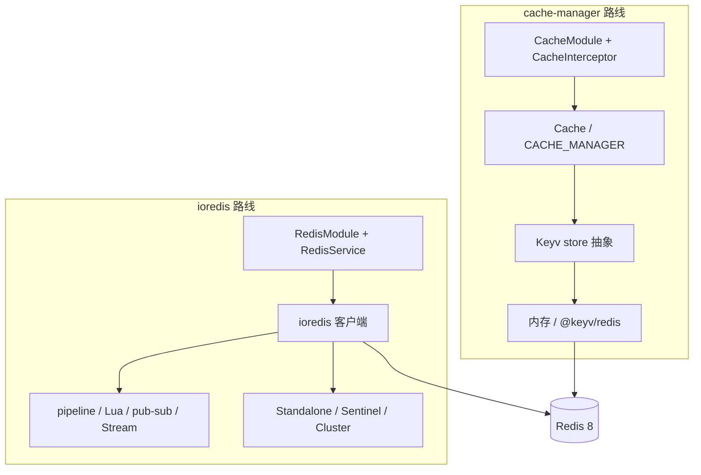

# 第 53 章 为什么推荐 ioredis 而不是 cache-manager 操作 Redis

上一章我们用 ioredis 把 Redis 接进了 Nest。Nest 官方文档里还有另一套写法：`CacheModule` + cache-manager。两套都能让接口变快，但它们解决的不是同一个问题。这一章先把两者各自在解决什么讲清楚，再给对比。

## 先把两个东西分清楚

**cache-manager 不是 Redis 客户端。** 它是「键值缓存」的抽象层：对外统一 `get` / `set` / `del`，底下可以接进程内存、Redis、SQLite。像共享充电宝柜：你只关心插上能充电，不用管里面是哪个品牌的电芯、多少毫安。

没有它会卡在哪？你只想缓存几个 GET 响应，也得自己写 `get` / `set`、序列化、TTL、失效，重复代码一多，缓存就成了每个接口都要抄一遍的体力活。cache-manager 把这些收成一个接口，Nest 再包一层拦截器，连 `get` / `set` 都省了。

它和 ioredis 最容易混的地方：cache-manager 只给你最小的一套键值接口，Lua、pub/sub、Stream 都不在它的菜单里。它不是「简化版 ioredis」，它解决的是另一类问题。

**ioredis 是完整的 Redis 客户端。** `get` / `set` 只是它能力的一小部分；pipeline、Lua、pub/sub、Stream、重连策略都直接暴露给你。像直接拿到仓库钥匙：货架随便你摆，但进出库登记、消防、盘点都得自己管。

没有它会卡在哪？需要原子操作、频道、消息队列时，cache-manager 表达不出来，只能返工换客户端。它和 cache-manager 的差别不是「谁更快」，是「能力边界到哪」。

Nest 在 cache-manager 上面又包了两样东西：`CacheModule` 负责依赖注入，`CacheInterceptor` 负责把 GET 响应自动写进缓存、下次直接返回。中间那层适配叫 Keyv，一个多后端键值存储抽象。Keyv 像电源转接头：不同国家的插座（内存、Redis、SQLite）都能插到同一个接口上，换后端不用改业务代码。

最小的接法是：

```ts
// src/app.module.ts（节选）
CacheModule.register({
  ttl: 5_000, // 毫秒
  isGlobal: true,
});
```

要换成 Redis 后端，装 `@keyv/redis`，用 `createKeyv()` 造一个 store（后端适配器）塞进 `stores` 数组。注入进来的 `Cache` 主要就 `get`、`set`、`del`、`clear` 几招。

它真正省事的地方在拦截器：

```ts
// src/modules/stats/stats.controller.ts
import { CacheInterceptor, CacheTTL } from '@nestjs/cache-manager';
import { Controller, Get, UseInterceptors } from '@nestjs/common';

@Controller('stats')
@UseInterceptors(CacheInterceptor)
export class StatsController {
  @Get('overview')
  @CacheTTL(60_000)
  overview() {
    return this.statsService.overview();
  }
}
```

业务代码一行没改，缓存就有了。代价是你只能在它画好的这个盒子里操作。

> **图 53-1** 两条路线各自能碰到的东西。



## 拦截器的边界，比文档写的更硬

先记住一条：**`CacheInterceptor` 的默认 key 是请求 URL**。它拿不到业务语义，只能拿 URL 当 key，所以它本质上只能做「响应缓存」——同一个 URL 对所有人返回同一份数据，才谈得上正确。

像快递柜按楼层放，不按收件人：301 室的格子谁都能开，只要他站在 301 门口。URL 就是楼层，用户就是收件人，两者对不上就会拿错。

review 一个 PR：统计缓存的 `RedisService` 换成了 `CacheModule`，删掉八十多行，只留一个 `@CacheTTL(60_000)`。代码确实短了一截。但 `/api/bookings` 也是 GET，会被全局 `CacheInterceptor` 缓存吗？会。key 里带用户 id 吗？不带——默认 key 是请求 URL，用户 A 的预订列表被缓存下来，用户 B 请求同一个 URL 就直接拿到 A 的数据。

这不是 cache-manager 的 bug，是选错了层。用错不会报错，只会在某个边界上以最难查的方式暴露。

其余的边界也一并列清楚：

- 只缓存 GET。手写 `@CacheKey()` 的路由会绕过这个判断，POST 也能被缓存。
- 注入 `@Res()` 的路由不生效，因为响应不走 Nest 的返回管线。
- GraphQL 不适用，每个 field resolver 都会单独跑拦截器，缓存粒度对不上。
- key 不带用户、租户、语言，任何「同 URL 不同人看到不同数据」的接口都不能直接套。
- TTL 单位是毫秒，`0` 表示永不过期。
- 内存 store 返回的是同一个对象引用，改它等于改缓存；Keyv store 走 JSON 序列化，`Date` 变字符串、类实例变普通对象。
- 未命中时 `get()` 当前返回 `undefined`；cache-manager v6 返回 `null`，从老版本迁过来时两个都要当未命中。

要按用户分 key，就得子类化拦截器、覆写 `trackBy`：

```ts
// src/common/interceptors/user-cache.interceptor.ts
import { CacheInterceptor } from '@nestjs/cache-manager';
import { ExecutionContext, Injectable } from '@nestjs/common';

interface RequestWithUser {
  url: string;
  user?: { id: string };
}

@Injectable()
export class UserCacheInterceptor extends CacheInterceptor {
  trackBy(context: ExecutionContext): string | undefined {
    const request = context.switchToHttp().getRequest<RequestWithUser>();
    const userId = request.user?.id ?? 'anonymous';
    return `user:${userId}:${request.url}`;
  }
}
```

即便这样也要确认 `request.user` 在拦截器执行时已经填好。Nest 的执行顺序是 Middleware → Guard → Interceptor → Pipe → Handler（第 17 章讲中间件、第 13 章讲守卫、第 18 章讲拦截器）。认证守卫正常注册时，拦截器里能拿到用户；如果认证还没跑，key 里就永远是 `anonymous`，等于没分人。

## ioredis 那侧多出来的是什么

ioredis 暴露的是 Redis 协议本身。除了 `get` / `set`，你还拿到：

- **pipeline**：一次往返发多条命令，批量读写不必按 RTT（往返时延，一次网络来回）收费。第 52 章用它一次取过多个 key。
- **Lua**：把「读—判断—写」封成原子脚本，计数、限流、分布式锁都靠它。第 52 章的 `INCR` + `EXPIRE` 就是例子。
- **pub/sub**：频道订阅，做缓存失效通知。第 52 章讲过它「发出去就不管」，丢了不补。
- **Stream**：带消费组和确认的消息队列，比拿 List 硬凑可靠；第 52 章提过它适合不能丢的消息。要补发、要签收时用它。
- **Sentinel / Cluster**：Sentinel 像备用钥匙管理员，主节点倒了自动把新主节点的地址给你；Cluster 像把仓库分成几个分店，按货号去对应分店取。没有它们，单机挂了只能人工切，数据多了单机也装不下。
- **连接控制**：`retryStrategy`、`enableOfflineQueue`、`maxRetriesPerRequest`，断线时快速失败还是排队，你说了算。

代价是这些都要自己写：key 规范、序列化、降级、连接生命周期、错误监听。第 52 章那一百多行就是代价的账单。

有个常见误解得先破掉：「ioredis 更底层，所以更快」。同一条 `GET`，两边最终都落到 Redis，吞吐差异可以忽略。真正的差异在能力边界和故障行为——cache-manager 的 Redis store 断线时怎么处理，取决于 Keyv 适配器；ioredis 的重连节奏、离线队列、命令重试，全在你能配的那几个参数里。

## 一张表看清

| 维度 | cache-manager | ioredis |
| --- | --- | --- |
| 定位 | 键值缓存抽象 + HTTP 拦截器 | 完整 Redis 客户端 |
| 默认后端 | 进程内存（Keyv） | Redis |
| 接 Redis | `@keyv/redis` 的 `createKeyv()` | 原生连接串 |
| TTL 单位 | 毫秒 | 秒（`EX`）或毫秒（`PX`） |
| 序列化 | 内存引用 / Keyv JSON | 自己做 |
| 批量 | 取决于 store | pipeline、`mget` |
| 原子操作 | 不提供 | Lua、`MULTI/EXEC`（Redis 的事务命令） |
| pub/sub | 不提供 | 提供 |
| Stream | 不提供 | 提供 |
| Sentinel / Cluster | 取决于 Keyv 适配器 | 原生支持 |
| 自动缓存 GET | `CacheInterceptor` | 自己写 |
| 失效粒度 | URL 或 `@CacheKey` | 任意 key |
| 故障处理 | Keyv 的 `error` 事件 | 重连策略、离线队列、命令重试 |

## 什么时候它更合适

别把 cache-manager 当成「简化版 ioredis」，它解决的是另一类问题。下面这些场景，用它确实更省：

- 只缓存几个 GET 响应，key 就是 URL，没有按用户、按租户的差异。
- 团队不想维护连接、序列化、降级这些基础设施。
- 单实例部署，或者能接受每个 Pod 各存一份内存缓存。
- 原型阶段先验证「缓存有没有用」，再决定要不要上 Redis。
- 已经用 Keyv 统一了多后端，不想再引一个客户端。

为了「以后可能要用 Lua」提前上 ioredis，同样是过度设计。

这个会议室系统最后选了 ioredis，原因是需求已经越过那条线：

- **缓存 key 带业务维度**。`meeting:room:42:detail`、`meeting:stats:2026-11`，还要按前缀批量失效，URL 做 key 表达不了。
- **统计和排行榜共用 Redis**。排行榜用 ZSet、计数用 `INCR`，这些不是「缓存响应」，`Cache` 接口根本表达不出来。
- **需要原子性**。预订冲突检查要锁行，计数和 TTL 要一起设，Lua 是现成工具。
- **需要 pub/sub 或 Stream**。缓存失效通知、异步任务都在客户端的能力范围里。
- **连接行为要可控**。Redis 是可选依赖，断了要快速失败、自动重连、恢复后自动启用。
- **未来可能上 Sentinel 或 Cluster**。换连接串就能接，不用换一层抽象。

一句话：**Redis 只用来缓存 HTTP 响应，cache-manager 够用；Redis 参与业务语义，就选 ioredis。**

两者也能共存，但要接受两个客户端就是两组连接、两套 key 规范、两条失效路径，出问题先得判断是哪一层。中小项目里统一成一套通常更省心。

## 迁移时最容易被忽略的五件事

**第一，TTL 单位。** cache-manager 是毫秒，ioredis 的 `EX` 是秒：

```ts
// 迁移前：60_000 毫秒
await this.cache.set('stats:overview', overview, 60_000);

// 迁移后：60 秒，单位写进参数名和常量
await this.redis.setJson(cacheKeys.statsOverview, overview, jitter(60));
```

把 `60_000` 直接抄到 `EX` 后面，缓存会存十六个小时；反过来把 `60` 传给 cache-manager，60 毫秒就过期，看起来像「缓存完全没生效」。这就像把厘米当米：数字没变，量级全错。

**第二，未命中的返回值。** cache-manager 当前返回 `undefined`（v6 是 `null`），`RedisService.getJson` 返回 `null`。判断写成 `value === null || value === undefined`，或者在封装层归一。别用 `if (!value)`——缓存里存 `0`、`''`、`false` 都合法，会被当成未命中。

**第三，key 的语义变了。** 拦截器的 key 是 URL（可能带 query），你的 key 是业务前缀。迁移不是换个 `get` 调用，是把「什么算同一个缓存条目」重新定义一遍。老 key 要么等 TTL 淘汰，要么按前缀清一次。

**第四，序列化格式。** 内存 store 存引用，Keyv store 存 JSON，ioredis 存的是你 `JSON.stringify` 之后的字符串。同一个 key 在两套代码间切换时，读出来的结构可能不一样，尤其是 `Date` 和嵌套的可选字段。灰度期间让两套 key 分开，别让新旧代码读同一个 key。

**第五，错误处理。** Keyv 的 Redis store 必须挂 `'error'` 监听，官方文档专门警告过：没人听的时候 Keyv 会抛错，可能直接把进程带崩。ioredis 同理，监听器挂在客户端上。迁移时两边的监听都要在。

## 把默认 key 打出来看一眼

不用猜。开 `MONITOR`：

```bash
docker compose exec redis redis-cli monitor
```

另开一个终端请求一次，假设这个路由被拦截器缓存了：

```bash
curl -s 'http://localhost:3000/api/bookings?page=1' -H 'Authorization: Bearer <token>' > /dev/null
```

示例输出：

```text
1700000123.401 [0 172.18.0.1:52344] "GET" "http://localhost:3000/api/bookings?page=1"
```

key 就是完整 URL，没有用户 id、没有角色。看到这一条，就该知道它不能用在按用户返回的数据上。

顺便验证 TTL 单位：

```bash
docker compose exec redis redis-cli ttl 'http://localhost:3000/api/bookings?page=1'
# (integer) 60
```

`@CacheTTL(60_000)` 落成 Redis 里大约 60 秒；如果看到 `60000`，说明有人把毫秒直接塞进了 `EX`。这个数字对不上，缓存策略基本就是错的。

## 几个真会出事的写法

**把用户相关的 GET 交给全局拦截器。** 前面那个 PR 就是。`/api/bookings?page=1` 对管理员和普通用户是同一个 key，谁的响应先被缓存，后来的人就看到谁的数据。要么不缓存这类接口，要么自定义 `trackBy`。

**用 `@CacheKey()` 缓存写接口。** 显式写 `@CacheKey()` 会绕过「只缓存 GET」的检查。给 POST 加缓存，第一次请求创建了订单，第二次直接返回缓存，看起来「幂等」了，实际什么也没做。

**TTL 设 0 或者不设。** cache-manager 里 `0` 是永不过期，ioredis 里不写 `EX` 也是永不过期。内存和 Redis 都只会慢慢涨，直到某天 OOM。

**多副本用内存 store。** 每个 Pod 一份缓存，失效时只删掉自己那份，用户刷新两次可能看到两个结果。内存 store 适合单实例，或者能容忍不一致的场景。

**在共用 Redis 上调用 `clear()`。** `clear()` 的作用范围由 store 决定，`@keyv/redis` 在共享实例上可能清掉不属于缓存的 key。生产上宁可显式 `del` 已知前缀。

## 判断标准只有一条

选型不是站队。cache-manager 把「缓存一个 GET 响应」做得很便宜，ioredis 把 Redis 的全部能力交给你；前者省代码，后者省「这个需求做不了」的返工。判断标准只有一条：**Redis 在你系统里只是响应缓存，还是业务的一部分。**

这个项目里排行榜、计数、会话、锁都要用 Redis，所以从第一天就选了 ioredis，缓存只是它顺带承担的一件事。等你的系统里出现第一个需要原子性或 Stream 的场景，大概也会做同样的选择。

这几页官方文档对应正文里的几个点，读完再看：[Nest 缓存](https://docs.nestjs.com/techniques/caching)（`CacheModule` 和 `CacheInterceptor` 的官方说明，对应开头两段）、[cache-manager](https://github.com/jaredwray/cacheable/tree/main/packages/cache-manager)（这层抽象自己的 API 和接入方式）、[Keyv](https://keyv.org/docs/)（cache-manager 底下的存储层，错误事件就是它抛的）、[ioredis](https://github.com/redis/ioredis)（完整客户端的入口，注意它暴露的能力范围）、[Redis 文档](https://redis.io/docs/latest/)（判断某个能力该由谁提供时翻）。

<!-- chapter-nav:start -->
---

← 上一篇：[052 在Nest里操作Redis](052-在Nest里操作Redis.md) · [本 Part 目录](_part.md)
<!-- chapter-nav:end -->
