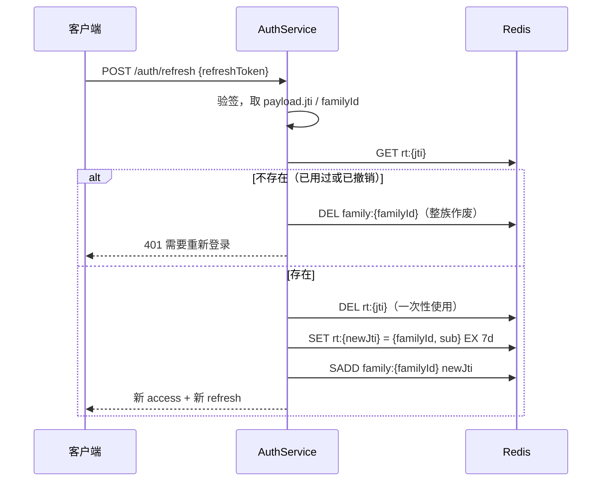

第 55 章结尾留了一句话：access 只有 15 分钟，用户不可能每 15 分钟手动登录一次。补上这个缺口的就是 refresh token —— 它让"短期凭证 + 长期续期"成立，用户全程无感。

但"无感"两个字背后是一串非常具体的工程问题：refresh 被偷了怎么办？两个请求同时发现 access 过期，会触发几次刷新？刷新到一半网络断了，重试会不会把自己踢下线？多开十个标签页会不会互相把对方的会话作废？

这一章把 refresh 轮换（rotation）写完整，包括重放检测和并发控制。它是第 54 章那张对比表里"撤销"一行的落地，也是登录功能从"能跑"到"敢上线"的分界线。

## 为什么 refresh 必须轮换

最省事的做法是：refresh 签一个 7 天有效、内容固定的令牌，过期前一直用它换 access。这有一个致命问题——**refresh 一旦泄漏，攻击者可以安静地续命 7 天**，你甚至不知道有人在用。

因为你只有一条 refresh、服务端不记录它被用过，所以每次使用都"看起来正常"。

轮换的做法是：**refresh 一次性使用**。每次刷新都作废旧 refresh、签发新的；服务端在 Redis 里记录"这条 refresh 属于哪个家族（family）、用过没有"。于是有两个新能力：

- 重放检测：一条已经用过的 refresh 又出现了，说明有两个人拿着同一张票——要么用户自己重复提交，要么令牌被偷了。**这时不能只拒绝这一次，要把整个家族全部作废**，逼双方重新登录。攻击者拿到的旧票失效，用户重登后攻击者也没有新票。
- 家族追溯：一次登录产生一个 familyId，所有后续 refresh 共享它。作废家族 = 作废这次登录派生出的所有凭证。

代价是每次刷新多两次 Redis 操作，以及"必须处理并发"。后面会看到，并发才是真正花时间的地方。



## 两张 Redis 表就够了

不需要建数据库表。refresh 的生命周期是"7 天内、随时可撤销"，正好是 Redis TTL 的强项：

```ts
// src/modules/auth/refresh-store.service.ts
import { Injectable } from '@nestjs/common';
import { RedisService } from '../../redis/redis.service.js';

export interface RefreshRecord {
  familyId: string;
  userId: string;
  createdAt: number;
}

@Injectable()
export class RefreshStoreService {
  private static readonly RT = 'rt:';
  private static readonly FAMILY = 'rtfamily:';

  constructor(private readonly redis: RedisService) {}

  async register(jti: string, record: RefreshRecord, ttlSeconds: number): Promise<void> {
    await this.redis.setJson(`${RefreshStoreService.RT}${jti}`, record, ttlSeconds);
    await this.redis.sadd(`${RefreshStoreService.FAMILY}${record.familyId}`, jti);
    await this.redis.expire(`${RefreshStoreService.FAMILY}${record.familyId}`, ttlSeconds);
  }

  async consume(jti: string): Promise<RefreshRecord | null> {
    const key = `${RefreshStoreService.RT}${jti}`;
    const record = await this.redis.getJson<RefreshRecord>(key);
    if (!record) {
      return null;
    }
    await this.redis.del(key);
    return record;
  }

  async revokeFamily(familyId: string): Promise<void> {
    const setKey = `${RefreshStoreService.FAMILY}${familyId}`;
    const members = await this.redis.smembers(setKey);
    if (members.length > 0) {
      await this.redis.del(...members.map((jti) => `${RefreshStoreService.RT}${jti}`));
    }
    await this.redis.del(setKey);
  }
}
```

`consume` 的语义是"读出来并删除"，这两步必须尽量原子。若要求严格，用 Lua 脚本替代；若接受极小概率的并发漏判（后果只是多一次刷新），应用层先 `get` 后 `del` 足够。

## 服务端的刷新逻辑

```ts
// src/modules/auth/auth.service.ts（节选：refresh）
async refresh(dto: RefreshTokenDto): Promise<AuthResponseDto> {
  let payload: JwtPayload;
  try {
    payload = await this.jwt.verifyAsync<JwtPayload>(dto.refreshToken, {
      secret: this.refreshSecret,
    });
  } catch {
    throw new UnauthorizedException('refresh token 无效或已过期');
  }

  if (payload.type !== 'refresh' || !payload.jti || !payload.familyId) {
    throw new UnauthorizedException('refresh token 类型不正确');
  }

  const record = await this.refreshStore.consume(payload.jti);
  if (!record) {
    // 已用过却再次出现：不是重试就是被盗，整族作废
    await this.refreshStore.revokeFamily(payload.familyId);
    await this.redis.setJson(`auth:reused:${payload.jti}`, true, 60 * 60 * 24);
    throw new UnauthorizedException('refresh token 已被使用，请重新登录');
  }

  const user = await this.users.findById(payload.sub);
  if (!user) {
    await this.refreshStore.revokeFamily(payload.familyId);
    throw new UnauthorizedException('用户不存在或已被删除');
  }

  return this.issueTokens(user, payload.familyId);
}
```

三个细节值得单独说：

**第一，重放要留痕。** `auth:reused:{jti}` 这行是给运维看的：出现了多少次、集中在哪些 IP、是不是某批客户端在疯狂重试。只返回 401 而不记录，等于放弃了一次发现盗用的机会。

**第二，家族要一致。** 第一次登录时 `familyId = randomUUID()`；之后每次刷新都带同一个 familyId。这样"用户在多台设备登录"天然隔离——设备 A 的家族被作废，不影响设备 B。

**第三，`issueTokens` 要复用。** 登录和刷新签发的是同一套令牌，别写两遍。把 familyId 作为可选参数传进去：

```ts
// src/modules/auth/auth.service.ts（节选：签发）
private async issueTokens(user: UserRow, familyId: string = randomUUID()) {
  const base = { sub: user.id, email: user.email, role: user.role };
  const jti = randomUUID();

  const accessToken = await this.jwt.signAsync(
    { ...base, type: 'access' },
    { secret: this.accessSecret, expiresIn: this.accessExpiresIn },
  );
  const refreshToken = await this.jwt.signAsync(
    { ...base, type: 'refresh', jti, familyId },
    { secret: this.refreshSecret, expiresIn: this.refreshExpiresIn },
  );

  await this.refreshStore.register(
    jti,
    { familyId, userId: user.id, createdAt: Date.now() },
    this.refreshTtlSeconds,
  );

  return {
    accessToken,
    refreshToken,
    tokenType: 'Bearer',
    expiresIn: this.accessExpiresIn,
    user: { id: user.id, name: user.name, email: user.email, role: user.role, avatarUrl: user.avatarUrl ?? null },
  };
}
```

## 并发才是真正的难点

设想用户在列表页，页面同时发了 6 个请求。access 刚好过期，6 个 401 同时回来，前端如果有 6 个独立的"刷新逻辑"，就会有 6 次 `POST /auth/refresh`。而 refresh 是一次性的：

1. 6 个请求带着**同一个** refresh 并发到达；
2. 第一个 `consume` 成功，其余 5 个拿到 null；
3. 按上面的逻辑，5 个"重放"触发 `revokeFamily`；
4. 用户被踢下线。

一个正常的页面加载把用户踢掉，这是轮换方案最经典的翻车方式。必须两头一起修。

**服务端：给重放留一个宽限窗口。** 网络重试、客户端并发，都会让同一 refresh 在极短时间内被用两次。把它区分成"刚刚用过"和"很久以前用过"：

```ts
// src/modules/auth/auth.service.ts（节选：consume 的替代实现）
const record = await this.refreshStore.consume(payload.jti);
if (!record) {
  const tombstone = await this.redis.getJson<{ replacedBy: string }>(`rt:used:${payload.jti}`);
  if (tombstone) {
    // 10 秒内重复使用：视为并发/重试，把上一次刚签发的 refresh 还回去
    const current = await this.users.findById(payload.sub);
    if (current) {
      const replay = await this.refreshStore.reissueFor(payload.jti, payload.familyId, current);
      if (replay) return replay;
    }
  }
  await this.refreshStore.revokeFamily(payload.familyId);
  throw new UnauthorizedException('refresh token 已被使用，请重新登录');
}
```

`consume` 成功时同时写 `rt:used:{jti} = { replacedBy: newJti }`，TTL 10 秒。这个墓碑就是"我刚被用掉、新票是哪个"的便条。宽限窗口别设长——10 秒足够覆盖一次网络抖动，也短到攻击者来不及利用。

**客户端：刷新必须串行化。** 一行 401 就刷新一次的代码是错的，正确做法是"第一个 401 触发刷新，其余 401 排队等结果"：

```ts
// web/src/lib/http.ts（节选：fetch 版本的刷新队列）
let refreshing: Promise<string> | null = null;

async function request(input: RequestInfo, init: RequestInit = {}): Promise<Response> {
  const send = () =>
    fetch(input, {
      ...init,
      credentials: 'include',
      headers: { ...init.headers, Authorization: `Bearer ${getAccessToken()}` },
    });

  let res = await send();
  if (res.status !== 401 || isAuthPath(input)) return res;

  refreshing ??= refreshAccessToken().finally(() => {
    refreshing = null;
  });

  try {
    await refreshing;
  } catch {
    redirectToLogin();
    throw new Error('登录已过期');
  }
  return send(); // 用新 access 重放这一次请求
}
```

关键在 `refreshing ??= ...`：第一个请求创建 promise，其余请求拿到同一个 promise。**刷新的次数永远是 1**，与并发请求数无关。重放时只重放一次，不要递归——否则 refresh 本身 401 时会死循环。

## refresh 该放在哪

令牌放哪决定了攻击面，比算法选择重要得多。三种常见位置：

| 位置 | XSS 能偷吗 | CSRF 风险 | 页面刷新后还在吗 | 适用 |
| --- | --- | --- | --- | --- |
| `localStorage` | 能，直接读 | 无（不会自动发送） | 在 | 内部工具、快速原型 |
| 内存变量 | 不能 | 无 | 不能，刷新即丢 | access token 的常见归宿 |
| `HttpOnly` cookie | 不能（JS 读不到） | 有，需要 `SameSite` + CSRF token | 在 | refresh token 的常见归宿 |

本项目的组合是：**access 放内存，refresh 放 `HttpOnly` cookie**。页面加载时先尝试用 cookie 静默换一次 access，换不到就跳登录页。这个组合的代价是"刷新页面后必须多一次往返"，收益是 XSS 拿不到 refresh——而 XSS 在真实世界里比 CSRF 常见得多，前端依赖一个被投毒的 npm 包就够了。

如果 refresh 走 cookie，就必须同时处理 CSRF：写操作校验 `Origin`/`Referer`，或者给 refresh 接口单独加一个 CSRF token。这里有一个容易踩的细节——`SameSite=Lax` 只拦跨站 POST，拦不住同站的 XSS 发起的请求，所以"有 XSS 就必然失守"这一点要提前想清楚。

## 别忘了绝对过期上限

轮换还有一个副作用：每次刷新都重签 refresh，`exp` 跟着往后推，于是"7 天"变成了**滑动窗口**——用户只要 7 天内来过一次，就能永远续下去。这在一个被盗的浏览器里非常危险。

标准做法是加两层限制：

- refresh 自身 7 天有效（滑动）；
- 登录产生的 family 有**绝对寿命**，比如 30 天。到点不管有没有活动，都得重新登录。

实现就在刷新时比较 `createdAt`：

```ts
// src/modules/auth/auth.service.ts（节选：绝对过期）
const MAX_FAMILY_AGE = 30 * 24 * 60 * 60 * 1000;
if (Date.now() - record.createdAt > MAX_FAMILY_AGE) {
  await this.refreshStore.revokeFamily(record.familyId);
  throw new UnauthorizedException('登录状态已超过最长有效期，请重新登录');
}
```

这也解释了为什么 `RefreshRecord` 里要存 `createdAt` ——它不是为了展示，是为了算这条家族还能活多久。很多团队只做了滑动续期，上线一年后才发现"用户可以无限续期"这件事。

## 长连接与移动端的边界

HTTP 请求有 401 可以重试，长连接不行。SSE、WebSocket 建立连接后不存在"每次请求带 token"的机会，access 过期时连接仍然活着——服务端要么在消息通道里下发"令牌即将过期"，要么等客户端定时重连。

本项目的处理是：网关在握手时校验 access，并在连接上绑定 `sub` 与 `exp`；到期前 60 秒推一条 `auth:expiring` 事件，客户端收到后刷新并带新 token 重连。**不要在服务端凭 `exp` 强行断开**——断开的瞬间用户正在输入，体验非常糟；让它自然过期、由客户端重建连接更平滑。

移动端还有两个额外问题。一是 App 被系统挂起后定时器不跑，恢复时 access 可能已经过期几小时，这时候要**用 refresh 静默换**而不是弹登录页；二是弱网下刷新请求可能超时但服务端已经处理，客户端重试就会撞上"重放"，这正是前面墓碑宽限窗口存在的第二个理由。没有服务端那 10 秒宽容，弱网体验会差到用户以为被莫名其妙踢下线。

## checkpoint：验证轮换与重放

浏览器多个标签页共享 cookie/localStorage，但**共享不了内存里的 promise**。所以"刷新队列"在多标签页场景下会退化成：每个标签页各刷一次。如果 refresh 走的是 HttpOnly cookie，服务端会看到多个不同标签页的并发刷新——又是上面那个问题，靠宽限窗口兜住。

更稳的做法是用 `BroadcastChannel` 让标签页之间通信，或者用 Web Locks API 把刷新动作串行化：

```ts
// web/src/lib/refresh-lock.ts（节选）
export async function withRefreshLock<T>(fn: () => Promise<T>): Promise<T> {
  if (!('locks' in navigator)) return fn();
  return navigator.locks.request('token-refresh', fn);
}
```

`navigator.locks` 在主流浏览器都已支持，没有就降级。这一段代码量很小，但它决定了"用户开了 8 个标签页会不会被踢"。

如果你的 refresh 放在请求体里（而不是 cookie），那还要考虑存储位置：`localStorage` 方便但 XSS 可读，内存变量最安全但刷新页面就丢。常见折中是"access 放内存，refresh 放 HttpOnly cookie，页面加载时用 cookie 静默换一次 access"——这也是本项目的做法。

## checkpoint：验证轮换与重放

```bash
# 1) 登录拿一对 token
PAIR=$(curl -s -X POST http://127.0.0.1:3000/api/auth/login \
  -H 'Content-Type: application/json' \
  -d '{"email":"demo@example.com","password":"Passw0rd!"}')
OLD_RT=$(echo "$PAIR" | jq -r '.data.refreshToken')

# 2) 第一次刷新：成功，拿到新的 refresh
NEW=$(curl -s -X POST http://127.0.0.1:3000/api/auth/refresh \
  -H 'Content-Type: application/json' -d "{\"refreshToken\":\"$OLD_RT\"}")
echo "$NEW" | jq -r '.data.accessToken | length > 20'
# 预期：true

# 3) 拿旧的 refresh 再来一次（模拟重放）
curl -s -o /dev/null -w '%{http_code}\n' -X POST http://127.0.0.1:3000/api/auth/refresh \
  -H 'Content-Type: application/json' -d "{\"refreshToken\":\"$OLD_RT\"}"
# 预期：401

# 4) 关键：上一步已经作废整个家族，新 refresh 也不能用了
NEW_RT=$(echo "$NEW" | jq -r '.data.refreshToken')
curl -s -o /dev/null -w '%{http_code}\n' -X POST http://127.0.0.1:3000/api/auth/refresh \
  -H 'Content-Type: application/json' -d "{\"refreshToken\":\"$NEW_RT\"}"
# 预期：401（第 3 步的重放触发了整族撤销）
```

第 4 步的预期值得停一下：**检测到重放的代价是"用户也得重新登录"**。这看起来粗暴，但它把"攻击者偷偷续命"变成了"双方都被迫重登"，用户会来投诉，你才知道出事了。安全设计里这叫"失败要响"。

## 一个反模式：前端自己解析 exp

很多前端代码会读 access 的 payload、解析 `exp`、提前 30 秒刷新。它能工作，但把"什么时候该刷新"交给了客户端时钟——用户电脑时间偏差 5 分钟、或者跨时区，就开始出现"明明刚登录就刷新失败"的怪事。

更稳的做法是**以 401 为准**：服务端是唯一有资格判断令牌是否有效的角色。前端的优化只做一件事——收到 401 时不要立刻跳登录页，先尝试静默刷新一次，失败才跳。如果确实想提前刷新（比如避免用户点击时卡一下），也只在前台空闲时做，并且把 401 兜底路径保留，不要把提前刷新当成唯一路径。

## 这一章在认证链路里的位置

| 章节 | 解决什么 | 关键产物 |
| --- | --- | --- |
| 054 | 状态放哪（选型） | 七维对比、事故清单 |
| 055 | 两种方式怎么跑通 | SessionGuard / JwtStrategy / 统一 `request.user` |
| 056 | 用户怎么注册登录 | `issueTokens`、bcrypt、唯一约束 |
| 057 / 058 | 登录后能做什么 | ACL / RBAC 边界 |
| 059（本章） | 令牌怎么续、怎么撤 | 轮换、家族作废、并发队列 |

本章的 `issueTokens` 与第 56 章是同一份实现，本章只是给它加了 `familyId` 和 `jti` 的台账。读的时候可以把它看成"第 56 章登录成功后，接下来 7 天里发生的所有事"。

## 坑表

| 现象 | 原因 | 修法 |
| --- | --- | --- |
| 页面一加载就掉登录 | 并发 401 各刷一次，后到的被判重放 | 客户端刷新队列 + 服务端 10 秒墓碑宽限 |
| 刷新接口自己 401 后死循环 | 重放逻辑对 `/auth/refresh` 也生效 | 拦截器里排除 auth 路径 |
| 换了 refresh 后旧 access 立刻失效 | 想撤销 access 只能等它过期或走黑名单 | 短 access（15m）+ refresh 撤销，接受延迟 |
| 多标签页互相踢 | 内存队列不跨标签页 | `BroadcastChannel` 或 `navigator.locks` |
| 客户端时钟慢导致验签失败 | `exp` 按服务端时钟算，客户端只负责过期判断 | 前端不要自己解析 `exp` 决定刷新，以 401 为准 |
| 用户改密码后旧设备还能用 | 只换了密码，没作废 family | 改密码时遍历该用户全部 family 并作废 |
| 刷新记录越存越多 | family set 没有 TTL | `SADD` 后同 key `EXPIRE`，与 token 生命周期对齐 |
| 弱网下偶发掉登录 | 请求超时但服务端已消费，重试撞重放 | 墓碑宽限窗口调到 10–30 秒 |
| 监控看不到刷新异常 | 只打了 access 失败日志 | 单独埋点 `refresh_fail_reason`（过期/重放/用户不存在），按天看比例 |

最后一行是运维视角：刷新链路的健康度不该靠用户投诉发现。`refresh_fail_reason` 里"重放"占比突然升高，通常意味着有客户端在错误重试，或者令牌真的被批量盗用了；"用户不存在"占比升高，则多半是删号逻辑没同步撤销家族。把这两个数字放进监控，比任何安全文档都管用。

<!-- chapter-nav:start -->
---

← 上一篇：[058 基于RBAC实现权限控制](058-基于RBAC实现权限控制.md) · [本 Part 目录](_part.md) · 下一篇：[060 如何动态读取不同环境的配置](060-如何动态读取不同环境的配置.md) →
<!-- chapter-nav:end -->
