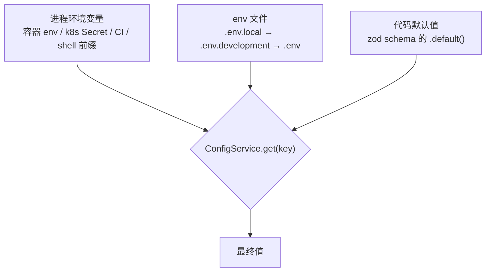

# 060 如何动态读取不同环境的配置

发布后十分钟，全站 401。

网关和另外两个服务用的是同一套密钥，登录接口也返回了 token，但每个受保护接口都验签失败。翻代码，签发逻辑没问题；翻配置，生产的环境变量里写的是 `JWT_ACCESS_SECERT`——多了一个字母，正确拼写是 `SECRET`。于是 `config.get('jwt.accessSecret')` 拿到 `undefined`，构造函数里的兜底值生效了：

```ts
this.accessSecret = config.get<string>('jwt.accessSecret') ?? 'dev-access-secret-change-me';
```

服务用开发默认密钥签出了每一枚 token，其他服务用生产密钥去验，自然全部失败。**最刺眼的不是拼写错误，是日志里连一句警告都没有**：配置缺失被兜底值接住了，接得悄无声息。

这一章讲的就是怎么让这类错误在启动时炸掉，而不是在流量里慢慢暴露。

## 配置的三个来源，和它们真正的优先级

同一个 key 可能来自三个地方，Nest 的读取顺序是固定的：

> **图 60-1** 一个配置项的来源与优先级：越靠上越优先，代码里的默认值永远是最后一道。



三件事值得掰开：

**第一，env 文件默认不覆盖已存在的进程变量。** `@nestjs/config` 用 dotenv 解析文件，写入 `process.env` 时有 `key in process.env` 的判断：已经存在的 key 直接跳过。所以 `DATABASE_URL=... pnpm start:dev` 会赢过 `.env` 里的同名项——这是好事，容器和 CI 注入的配置不会被仓库里的文件悄悄盖掉。

**第二，`envFilePath` 数组的顺序就是优先级。** 传 `['.env.local', '.env']`，先读到的 key 先占位，后面的同名项被跳过。所以「本地覆盖」只要把 `.env.local` 放前面。

**第三，默认值写在 schema 的 `.default()` 里，不要写 `?? 'x'`。** 前者在启动时一次性物化、有类型、能在文档里一眼看到全部默认值；后者散落在每个 `config.get` 后面，半年后没人知道生产到底该配哪些项。但默认值也是一把双刃剑——上面那起事故里，正是默认值把「缺失」伪装成了「正常」。

## ConfigModule.forRoot 的每个开关

```ts
// src/app.module.ts（节选）
ConfigModule.forRoot({
  isGlobal: true,
  cache: true,
  envFilePath: ['.env.local', '.env'],
  load: [configuration],
  validationSchema: envSchema,
});
```

逐个说：

- `isGlobal: true`：别的模块不用各自 `imports: [ConfigModule]`。代价是「配置在哪用」不再显式——靠纪律，不靠编译期。
- `cache: true`：`get()` 读一次就缓存，不再反复走 `process.env` 的查找与类型转换。注意它缓存的是「第一次读到的值」，测试里如果先构造了 app 再改 `process.env`，读到的还是旧值。
- `envFilePath`：可以是数组，顺序即优先级，见上文。
- `load`：命名空间工厂，把扁平的 `JWT_ACCESS_SECRET` 变成 `jwt.accessSecret`，下一节展开。
- `validationSchema`：Nest 12 起直接接受 Standard Schema（zod、ArkType 都实现了），启动即校验，失败就拒绝启动。这是本章最重要的一行。

还有几个不常用但会在特定场景咬人的：

- `skipProcessEnv: true`：`ConfigService.get` 完全无视 `process.env`，只认校验结果与 env 文件。适合「配置必须来自文件、不接受临时 shell 变量」的强约束环境。
- `validatePredefined`（默认 `true`）：启动前就已经在 `process.env` 里的变量也送去校验。设成 `false` 时，预定义变量原样返回、不校验不转换——`PORT=3000` 可能以字符串原样进来。
- `expandVariables: true`：支持 `.env` 里的 `${HOST}` 引用。开着更灵活，但也让「最终值」更难一眼看出。
- `ignoreEnvFile: true`：完全不用 env 文件，只认进程环境（容器部署的常见选择）。
- `override: true`：反过来让 env 文件覆盖进程变量。一般别开——它打破了「外部注入优先」这条安全默认。

## 校验：让缺失在启动时失败

### 用 Standard Schema（Nest 12）

```ts
// src/config/env.validation.ts
import { z } from 'zod';

const optionalUrl = z.preprocess(
  (v) => (v === '' || v === null || v === undefined ? undefined : v),
  z.url().optional(),
);

export const envSchema = z.object({
  NODE_ENV: z.enum(['development', 'test', 'production']).default('development'),
  PORT: z.coerce.number().int().min(1).max(65535).default(3000),
  CORS_ORIGINS: z.string().default('http://localhost:5173'),

  DATABASE_URL: z
    .string()
    .min(1, 'DATABASE_URL 不能为空')
    .refine((v) => /^postgres(ql)?:\/\//.test(v), {
      message: 'DATABASE_URL 必须是 postgres:// 或 postgresql:// 开头的连接串',
    }),
  DIRECT_URL: optionalUrl,
  REDIS_URL: optionalUrl,

  JWT_ACCESS_SECRET: z.string().min(16),
  JWT_ACCESS_EXPIRES_IN: z.string().default('15m'),
  JWT_REFRESH_SECRET: z.string().min(16),
  JWT_REFRESH_EXPIRES_IN: z.string().default('7d'),

  THROTTLE_TTL: z.coerce.number().int().min(1000).default(60_000),
  THROTTLE_LIMIT: z.coerce.number().int().min(1).default(100),
});
```

把它交给 `validationSchema`，框架负责解析与报错，不需要你写 `try/catch`：

```ts
ConfigModule.forRoot({
  isGlobal: true,
  validationSchema: envSchema,
  validationOptions: { abortEarly: false }, // 一次报出全部缺失项，而不是遇到第一个就停
});
```

启动失败的输出长这样，字段名直接可 grep：

```
Error: Environment validation failed:
  JWT_ACCESS_SECRET: Required
  DATABASE_URL: DATABASE_URL 必须是 postgres:// 或 postgresql:// 开头的连接串
```

### 用 validate 函数（旧写法，也还在）

```ts
export const validateEnv = (raw: Record<string, unknown>): z.infer<typeof envSchema> => {
  const result = envSchema.safeParse(raw);
  if (!result.success) {
    const details = result.error.issues
      .map((i) => `${i.path.join('.') || 'env'}: ${i.message}`)
      .join('; ');
    throw new Error(`环境变量校验失败: ${details}`);
  }
  return result.data;
};
```

两种写法的实际差别不只在风格：`validationSchema` 由框架合并「未声明的变量」，校验结果和 env 文件里的其他键一起进 `ConfigService`；`validate` 则是「你返回什么就是什么」，没返回的键会被丢掉（`skipProcessEnv` 的注释里那句 *whatever it returns is served* 说的就是这个）。**别两个都用**——叠加之后，你以为的优先级和实际的优先级不是一回事。

### 默认值的边界

注意上面 `JWT_ACCESS_SECRET` 故意**没有** `.default(...)`。有默认值意味着「忘配也能启动」，这正是开头那次事故的温床。判断标准很简单：**这个值错了会造成安全问题或连不上外部系统吗？**会，就必填；不会（端口、TTL、超时），就给默认值。

对已有项目不想一次改太猛，可以留默认值但加一条启动断言：

```ts
if (env.NODE_ENV === 'production' && env.JWT_ACCESS_SECRET.startsWith('dev-')) {
  throw new Error('生产环境不允许使用 dev- 开头的密钥');
}
```

## 命名空间：把扁平 env 变成有层级的配置

原始 env 是一张平表，`JWT_ACCESS_EXPIRES_IN`、`THROTTLE_TTL` 这类名字在业务代码里读起来很长，也看不出归属。`load` 把它们整理成树：

```ts
// src/config/configuration.ts
import { envSchema } from './env.validation.js';

export const configuration = () => {
  const env = envSchema.parse(process.env);

  return {
    environment: env.NODE_ENV,
    port: env.PORT,
    corsOrigins: env.CORS_ORIGINS.split(',').map((s) => s.trim()).filter(Boolean),
    database: { url: env.DATABASE_URL, directUrl: env.DIRECT_URL ?? env.DATABASE_URL },
    redis: { url: env.REDIS_URL },
    jwt: {
      accessSecret: env.JWT_ACCESS_SECRET,
      accessExpiresIn: env.JWT_ACCESS_EXPIRES_IN,
      refreshSecret: env.JWT_REFRESH_SECRET,
      refreshExpiresIn: env.JWT_REFRESH_EXPIRES_IN,
    },
    throttle: { ttl: env.THROTTLE_TTL, limit: env.THROTTLE_LIMIT },
  };
};

export type AppConfig = ReturnType<typeof configuration>;
```

这里 `envSchema.parse(process.env)` 是第二次解析——`validationSchema` 已经校验过一次了，为什么还 parse？因为工厂函数拿不到校验结果，只拿得到 `process.env`；重复解析保证「命名空间里的值和校验过的值同源」，也让 `pnpm build` 在没有 `.env` 时能靠默认值通过。如果介意这一次开销，可以只在工厂里做形状整理、把必填项的 `getOrThrow` 留给消费者，两者选一。

读取时给 `ConfigService` 带上类型参数，路径写错会变成编译错误而不是运行时 `undefined`：

```ts
constructor(private readonly config: ConfigService<AppConfig, true>) {
  this.port = config.getOrThrow('port', { infer: true });
  this.saltRounds = 10;
  this.secret = config.getOrThrow('jwt.accessSecret', { infer: true });
}
```

`ConfigService<AppConfig, true>` 的第二个泛型 `WasValidated` 为 `true` 时，`get` 的返回值不再带 `undefined`——「校验过就一定有值」这个事实被编码进了类型，`??` 兜底从源头消失。这是修掉开头事故最省事的一招：**把类型当成断言，让编译器替你查拼写**。

另一种组织方式是 `registerAs`，适合「一个域一个文件」：

```ts
import { registerAs } from '@nestjs/config';

export const jwtConfig = registerAs('jwt', () => ({
  accessSecret: process.env.JWT_ACCESS_SECRET!,
  accessExpiresIn: process.env.JWT_ACCESS_EXPIRES_IN ?? '15m',
}));

// 使用处
constructor(@Inject(jwtConfig.KEY) private readonly jwt: ConfigType<typeof jwtConfig>) {}
```

| | 单文件 `configuration` | 多文件 `registerAs` |
| --- | --- | --- |
| 一眼看全 | ✅ 一个文件 | ❌ 分散在各模块 |
| 模块自治 | ❌ 都往同一个文件加 | ✅ 就近定义 |
| 类型推导 | `ReturnType` + 路径字符串 | `ConfigType<typeof x>`，键名也是类型 |
| 适合 | 中小项目、配置项 < 30 | 大项目、按域拆 |

example 用的是前一种，这一章沿用它；等你写到多租户、支付、对象存储三个域各自一堆配置时，再换后一种不迟。

## 不同环境怎么「动态」

「动态」不是运行时热切换，而是**同一份代码在不同环境读到不同值**。做法只有一条：启动时决定读哪些文件、读哪些变量。

```ts
// src/app.module.ts 顶部
const nodeEnv = process.env.NODE_ENV ?? 'development';

ConfigModule.forRoot({
  isGlobal: true,
  envFilePath: [`.env.${nodeEnv}.local`, `.env.${nodeEnv}`, '.env.local', '.env'],
  validationSchema: envSchema,
  load: [configuration],
});
```

数组顺序就是优先级，从最具体到最通用：

| 文件 | 提交到仓库 | 用途 |
| --- | --- | --- |
| `.env.local` | 否 | 本机私有覆盖（自己的数据库、自己的密钥） |
| `.env.development` / `.env.production` | 是（不含 secret） | 环境的**非敏感**差异：日志级别、CORS 域名、功能开关 |
| `.env` | 否 | 默认值，团队统一 |
| `.env.example` | 是 | 变量清单与说明，新人照着建 `.env` |

`.gitignore` 里至少这几行：

```gitignore
.env
.env.local
.env.*.local
```

一个常见疑问：`NODE_ENV` 本身能不能从 `.env` 读？不能——读哪个文件要靠它决定，先有它才能选文件。所以它只能来自启动命令或容器：

```bash
NODE_ENV=production node dist/main.js
```

`pnpm start:dev` 在 `example/package.json` 里是 `nest start --watch`，`NODE_ENV` 由 Nest CLI 默认设为 `development`；生产镜像的 `CMD` 里必须显式写。

**环境差异不只是值，还包括开关**：

| 配置 | development | production |
| --- | --- | --- |
| 日志 | 彩色、含栈 | JSON、脱敏、`NODE_ENV` 影响异常过滤器是否回显栈 |
| CORS | `localhost:5173` | 真实域名，不带通配 |
| Swagger UI | 开 | 关，或加鉴权/只在内部网 |
| 数据库 | 本地 PG，可重建 | 生产库，迁移只走发布流程 |
| 密钥 | `.env.local` 里随便写 | Secret 管理器注入，绝不进镜像 |
| 限流 | 宽松 | 按真实流量设 |

把这些写成代码里的 `if (config.get('environment') === 'production')` 也可以，但更稳的是**让差异体现在配置值上**：`LOG_LEVEL`、`SWAGGER_ENABLED`、`CORS_ORIGINS` 各给一份，代码只读值、不判断环境。`if (isProd)` 散落十处之后，你想加个 staging 就得改十个地方。

## 只在边界读一次

反模式长这样：service 里到处 `config.get('jwt.accessSecret')`。问题有三个——每次调用都要走 find/转换；拼错的 key 编译期发现不了；改配置要读三个文件才知道「这个值最终从哪来」。

正确做法是在模块边界读一次，之后只传强类型对象：

```ts
ThrottlerModule.forRootAsync({
  inject: [ConfigService],
  useFactory: (config: ConfigService<AppConfig, true>) => [{
    ttl: config.getOrThrow('throttle.ttl', { infer: true }),
    limit: config.getOrThrow('throttle.limit', { infer: true }),
  }],
}),
```

更彻底一点，把「校验过的配置」做成一个 provider，消费者连 `ConfigService` 都不注入：

```ts
export const APP_CONFIG = Symbol('APP_CONFIG');

// app.module.ts
{
  provide: APP_CONFIG,
  inject: [ConfigService],
  useFactory: (config: ConfigService<AppConfig, true>) => ({
    port: config.getOrThrow('port', { infer: true }),
    corsOrigins: config.getOrThrow('corsOrigins', { infer: true }),
    jwt: {
      accessSecret: config.getOrThrow('jwt.accessSecret', { infer: true }),
      accessExpiresIn: config.getOrThrow('jwt.accessExpiresIn', { infer: true }),
    },
  } satisfies AppRuntimeConfig),
}
```

这样做的好处是**配置解析只发生一次**，测试里注入一个假对象就能覆盖；坏处是每加一个配置项要改两处（schema、provider）。项目规模上来之后，这点成本比「在 200 个文件里 grep `config.get`」便宜。

## 三个字符串陷阱

env 里的一切都是字符串，而你以为它是数字、布尔、数组。

```ts
// ❌ PORT 是字符串 '3000'，加 1 会变成 '30001'
const port = config.get<string>('PORT')!;
// ✅ schema 里 coerce
PORT: z.coerce.number().int().min(1).max(65535).default(3000)

// ❌ Boolean('false') === true，功能开关永远开着
const enabled = Boolean(process.env.CACHE_ENABLED);
// ✅ 枚举 + transform
CACHE_ENABLED: z.enum(['true', 'false']).default('false').transform((v) => v === 'true')

// ❌ 相对路径依赖 cwd，pm2/systemd 下会漂
const certDir = './certs';
// ✅ 相对模块 URL
const certDir = new URL('../certs', import.meta.url);
```

| 现象 | 原因 | 修法 |
| --- | --- | --- |
| 端口变成 `NaN` 或 `30001` | env 是字符串 | `z.coerce.number()` |
| 开关配了 `false` 却生效 | `Boolean('false')` 为真 | `z.enum(['true','false']).transform` |
| 数组只有一个元素 | `split(',')` 后有空格 | `.map(trim).filter(Boolean)` |
| 本地能跑、服务器找不到文件 | 相对路径依赖 cwd | `new URL(..., import.meta.url)` |
| 改了环境变量不生效 | `cache: true` 已缓存 | 重启；测试里注意构造顺序 |

## 生产落地：别把配置打进镜像

```dockerignore
.env
.env.*
!.env.example
```

三个部署事实：

1. **Compose 里 `environment` 覆盖 `env_file`。** 所以 `env_file: .env.production` 提供公共项，`environment:` 里钉死差异项（版本、副本标识），优先级写在明面上。
2. **Docker/K8s 的 secret 建议挂文件而不是进 env。** env 会被 `docker inspect`、崩溃转储、子进程继承带走；挂 `/run/secrets/jwt_access_secret` 后代码用 `readFileSync` 读，泄漏面小得多。代价是「配置来源不止一处」，schema 里要允许「值或文件路径」两种形式。
3. **配置变更 = 重启。** 12-factor 明确要求，因为热更会制造「同一集群里两种配置同时在跑」的状态；滚动发布期间新旧 Pod 配置不同，接口要能同时兼容。想在配置生效上做文章，先想清楚回滚。

一条容易立、收益很高的纪律：**改配置必须三件套一起改**——`envSchema` 加字段、`configuration()` 加映射、`.env.example` 加带注释的一行。只改其中两处，剩下那处就是下一次「新人照着 README 配完启动不了」的源头。code review 时把这三处当成一个原子变更来看，比事后补文档可靠。PR 模板里甚至可以加一句检查项：「新增环境变量了吗？schema、namespace、`.env.example` 都改了吗？」

想让「配置对不对」在启动后就可见，加一个脱敏摘要接口：

```ts
// src/modules/health/config-summary.ts
export const summarizeConfig = (env: Env) => ({
  environment: env.NODE_ENV,
  port: env.PORT,
  database: redactUrl(env.DATABASE_URL),   // 只留 host/db，丢掉账号密码
  redis: env.REDIS_URL ? 'configured' : 'disabled',
  jwt: { accessExpiresIn: env.JWT_ACCESS_EXPIRES_IN, secrets: 'configured' },
});

const redactUrl = (raw: string) => {
  const url = new URL(raw);
  return `${url.protocol}//${url.hostname}:${url.port}${url.pathname}`;
};
```

把 `summarizeConfig` 挂到第 050 章那个 `/api/health` 的返回里（加一行 `config: summarizeConfig(env)`），值班的人第一眼就能确认「这个 Pod 连的是哪个库、密钥有没有配」。**永远不要返回任何 secret 的值，连前缀都不要**——摘要的意义是「配了没有」，不是「配的是什么」。

## checkpoint：让配置错误在启动时炸掉

以下命令与预期错误类型未在本机实测；zod 的具体文案随版本略有差异，判断标准是「启动失败且报出字段名」。

```bash
# 1) 拼错变量名：因为 schema 里没给它默认值，直接启动失败
JWT_ACCESS_SECRET= pnpm start:dev
# 预期：Error: Environment validation failed:
#   JWT_ACCESS_SECRET: String must contain at least 16 character(s)

# 2) 连错数据库类型
DATABASE_URL=mysql://root@127.0.0.1:3306/demo pnpm start:dev
# 预期：DATABASE_URL 必须是 postgres:// 或 postgresql:// 开头的连接串

# 3) 端口写成非数字
PORT=abc pnpm start:dev
# 预期：PORT: Expected number, received nan
```

再看优先级是否按预期：

```bash
# .env.local 里 PORT=3100，.env 里 PORT=3000
pnpm start:dev
curl -s http://127.0.0.1:3100/api/health | jq '.data.config'
# 预期：port 是 3100（本地文件覆盖默认文件）

# 进程变量再压过文件
PORT=3200 pnpm start:dev
curl -s http://127.0.0.1:3200/api/health
# 预期：3200 能通，3100 连不上
```

## 坑表

| 现象 | 原因 | 修法 |
| --- | --- | --- |
| 生产用了开发密钥 | 必填项给了 `.default()` | 敏感项不设默认；生产加 `dev-` 前缀断言 |
| 拼错变量名，服务照常启动 | 同上，兜底值接住了缺失 | 删除默认值，`getOrThrow` + `WasValidated=true` |
| 容器里的配置被镜像里的 `.env` 盖住 | 开了 `override: true` | 保持默认（外部优先），`.dockerignore` 排除 `.env` |
| 本地改 `process.env` 不生效 | `cache: true` 缓存了首次读取 | 重启；测试里先设变量再建 app |
| `.env.local` 不生效 | 数组顺序写反，`.env` 在前 | 具体文件在前，通用文件在后 |
| `validationSchema` 与 `validate` 同时配 | 两套校验互相覆盖结果 | 只留一个 |
| `validate` 返回对象后某些变量没了 | `validate` 的输出即最终配置 | 返回完整对象，或改用 `validationSchema` |
| test 环境连到开发库 | `NODE_ENV` 没设，默认 development | 测试启动器显式传 `NODE_ENV=test` |
| `pnpm build` 在 CI 里失败 | 构建期 `configuration()` 就解析必填项 | 构建期给占位值，或把解析延迟到运行时 |
| 密钥出现在 `docker inspect` 输出里 | 密钥走 env | 改挂文件 / Secret 管理器 |
| 改了 `.env` 不重启以为生效 | 配置只在启动时读 | 配置变更纳入发布流程 |
| staging 与 prod 配置漂移 | 各改各的 `.env` | 公共项进 `.env.<env>` 并提交，差异项才注入 |

<!-- chapter-nav:start -->
---

← 上一篇：[059 基于access_token和refresh_token实现无感刷新登录状态](059-基于access_token和refresh_token实现无感刷新登录状态.md) · [本 Part 目录](_part.md) · 下一篇：[061 为什么要使用DockerCompose](061-为什么要使用DockerCompose.md) →
<!-- chapter-nav:end -->
